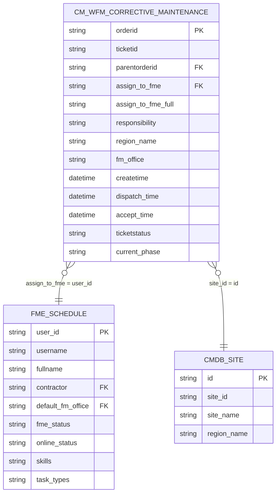

# Kamus Data: Mateline Utilization Dashboard

Dokumen ini adalah referensi dan kamus data resmi dari data source yang digunakan di ekosistem **Mateline Utilization Dashboard** (Huawei OWS / GDE).

---

## 1. Ikhtisar Data Source

| No | Nama Sumber / File Dump | Path Asal Datahub / Model | Deskripsi |
|---|---|---|---|
| 1 | `select * from ":CorrectiveMaintenance:CorrectiveMaintenance:cm_wfm_corrective_maintenance".csv` | `/CorrectiveMaintenance/CorrectiveMaintenance/cm_wfm_corrective_maintenance` | Master data seluruh transaksi tiket Work Order Corrective Maintenance (CM). |
| 2 | `select * from ":WFMBase:fme_service:fme_schedule".csv` | `/WFMBase/fme_service/fme_schedule` | Master jadwal teknisi lapangan (FME) dan status ketersediaan (*availability & live status*). |

---

## 2. Kamus Data Model 1: `cm_wfm_corrective_maintenance`

Model ini mencakup siklus hidup tiket gangguan CM dari dispatch, accept di aplikasi Mateline, penanganan di lokasi (depart/arrive), hingga selesai/tutup (complete/close).

### 2.1 Identitas Tiket & Relasi Alur
| Nama Field | Tipe Data | Deskripsi & Nilai Contoh |
|---|---|---|
| `orderid` / `orderidview` | String | Nomor unik tiket CM (contoh: `CM-20260310-00000001`). |
| `ticketid` / `keycode` | String | Identifier internal unik tiket. |
| `parentorderid` / `associateorderid` | String | Relasi ke tiket gangguan induk Incident Ticket NOC (`INC-20260310-00000002`). |
| `parentbpdtypeid` | String | Tipe proses induk (`Incident Ticket`). |
| `workflowtype` | String | Jenis workflow tiket (`Corrective_Maintenance`). |
| `task_type` | String | Jenis tugas (`CM`). |
| `ticketstatus` | String | Status tiket (`completed`, `running`, `cancel`). |
| `current_phase` | String | Tahap aktif tiket (`dispatch`, `complete`, `close`). |
| `title` | String | Judul tiket beserta detail alarm & waktu gangguan. |

### 2.2 Milestone Waktu & Metrik SLA (Acceptance Rate)
| Nama Field | Tipe Data | Deskripsi & Nilai Contoh |
|---|---|---|
| `createtime` | Datetime | Waktu tiket CM pertama kali dibuat di sistem (`2026-03-09 17:16:01`). |
| `dispatch_time` | Datetime | Waktu tiket di-dispatch ke FME oleh dispatcher / auto-dispatch. |
| `accept_time` | Datetime | **Kunci Utama**: Waktu FME menekan tombol *Accept* di aplikasi Mateline. Jika terisi, tiket dihitung sebagai *Accepted*. |
| `depart_time` | Datetime | Waktu FME menekan *Depart* (berangkat menuju lokasi site). |
| `arrive_time` | Datetime | Waktu FME menekan *Arrive* (sampai di lokasi fisik site). |
| `complete_time` | Datetime | Waktu teknisi menyelesaikan pekerjaan perbaikan di lapangan. |
| `closetime` | Datetime | Waktu konfirmasi penutupan tiket secara administratif. |
| `faultrecoverytime` | Datetime | Waktu pulihnya layanan/gangguan teknis. |
| `fault_first_occur_time` | Datetime | Waktu pertama kali alarm/isu gangguan terdeteksi. |
| `baseline_duration` | Number/String | Target durasi pengerjaan standar (menit, default `240`). |
| `slastatus` / `olastatus` | String | Status kepatuhan SLA/OLA (`normal`, `delay`, dll). |

### 2.3 Pelaksana FME & Mitra Kerja (Party)
| Nama Field | Tipe Data | Deskripsi & Nilai Contoh |
|---|---|---|
| `assign_to_fme` | String | Email/username FME penanggung jawab (`achmad.irvany@persada.id`). |
| `assign_to_fme_full` | String | Nama lengkap teknisi FME penanggung jawab (`Ahmad Tafiq Irvany`). |
| `responsibility` | String | Entitas mitra/party penanggung jawab (`Persada`, `Telkom Akses`, `Famika`, `TBG`, `IJE`). |
| `incidentequipmentvendor` | String | Vendor perangkat/mitra penyelesai tiket (`Persada`, `Others`, `TBG`, dll). |
| `party_name` | String | Klasifikasi party utama untuk dashboard: `Telkom Akses`, `Persada`, `Mandau`. |
| `dispatch_operator` | String | Operator atau sistem yang melakukan dispatch (`System` / nama user). |
| `accept_operator` | String | Akun FME yang menerima penugasan. |
| `depart_operator` | String | Akun FME yang melakukan depart. |
| `arrive_operator` | String | Akun FME yang melakukan arrive. |
| `complete_operator` | String | Akun FME yang men-submit completion tiket. |

### 2.4 Lokasi & Perangkat
| Nama Field | Tipe Data | Deskripsi & Nilai Contoh |
|---|---|---|
| `site_id` | String (UUID) | ID referensi site di CMDB. |
| `site_id_name` | String | Site ID / Site Code fisik (contoh: `33SKH_0039`, `JKU0009`). |
| `site_name` | String | Nama fisik site (contoh: `TBG_GATAK_SUKOHARJO`). |
| `region_name` | String | Nama wilayah operasional (`East Java`, `West Java`, `Central Java`, `Banten`, `DKI JAKARTA`). |
| `region` | String (UUID) | ID wilayah operasional di CMDB. |
| `fm_office` | String | Kantor cluster operasional FM (`MC JAKARTA_1`, `MC JEMBER`, `MC MALANG`, dll). |

### 2.5 Klasifikasi & Root Cause
| Nama Field | Tipe Data | Deskripsi & Nilai Contoh |
|---|---|---|
| `fault_type` | String | Jenis gangguan (`Wireless`, `Optical Cable`). |
| `root_cause` | String | Kategori penyebab gangguan (`Power`, `Alarm Clear`, `Others`, `Transmission`). |
| `sub_root_cause` | String | Detail sub penyebab (`UPS - Battery`, dll). |
| `cm_alarm_name` | String (UUID) | ID nama alarm penyebab. |
| `cm_fault_level` | String (UUID) | Tingkat severity tiket (Critical, Major, Minor, Indeterminate). |

---

## 3. Kamus Data Model 2: `fme_schedule`

Model ini mencakup master data profil personil teknisi lapangan (Field Maintenance Engineer) dan status operasional terkini.

### 3.1 Identitas & Mitra FME
| Nama Field | Tipe Data | Deskripsi & Nilai Contoh |
|---|---|---|
| `user_id` / `username` | String | Email/akun login FME (contoh: `muzakysyarif300@gmail.com`). Berelasi ke `assign_to_fme`. |
| `fullname` | String | Nama lengkap personil teknisi (contoh: `Muzaki Syarif Hidayat`). |
| `contractor` | String (UUID) | ID mitra/perusahaan kontraktor pengelola FME. |
| `mobile` | String | Nomor telepon teknisi (`006282114113146`). |
| `company` | String | Nama entitas perusahaan pengelola. |
| `active` | Boolean | Status aktifasi personil di sistem (`true`/`false`). |

### 3.2 Status Operasional & Ketersediaan (*Availability*)
| Nama Field | Tipe Data | Deskripsi & Nilai Contoh |
|---|---|---|
| `fme_status` | String | Status operasional teknisi di lapangan: `idle`, `waiting_depart`, `on_way`, `on_site`, `busy`, `offline`. |
| `online_status` | String | Status koneksi aplikasi mobile: `online`, `offline`, `busy`. |

#### Logika Klasifikasi Status Dashboard:
* **Idle**: `fme_status` bernilai `idle` atau `waiting_depart`.
* **Busy**: `fme_status` bernilai `busy`, `on_site`, atau `on_way`.
* **Offline**: `fme_status` bernilai `offline`.
* **Available**: `Idle + Busy`.
* **Availability (%)**: `(Available / Total FME) * 100`.

### 3.3 Penugasan Wilayah, Keahlian & Posisi
| Nama Field | Tipe Data | Deskripsi & Nilai Contoh |
|---|---|---|
| `default_fm_office` / `fm_office` | String (UUID) | Kantor/cluster operasional area kerja teknisi. |
| `skills` | String | Kualifikasi teknisi (`OSP`, `FWA Active`, `Tower`). |
| `task_types` | String | Tipe tugas yang diperbolehkan (`CM`, `PM`, dll). |
| `realtime_latitude` / `realtime_longitude` | Number | Koordinat posisi GPS FME terkini (jika aktif pelacakan). |

---

## 4. Hubungan Antar Tabel (Relational Mapping)

---

## 5. Logika Perhitungan Metrik Utama Dashboard

1. **Acceptance Rate (%)**:
   $$\text{Acceptance Rate} = \frac{\text{Total Tiket dengan } accept\_time \neq \text{null}}{\text{Total Tiket Dispatched/Diterima}} \times 100$$
2. **Snapshot Mode (D-1 vs Range)**:
   * **D-1**: Mengambil data satu hari kemarin dari tanggal default end range.
   * **Range**: Mengambil data berdasarkan filter rentang tanggal `start_date` sampai `end_date` yang dipilih pengguna.
3. **Party Sorting**:
   * Urutan baku party: `['Telkom Akses', 'Persada', 'Mandau']`.
